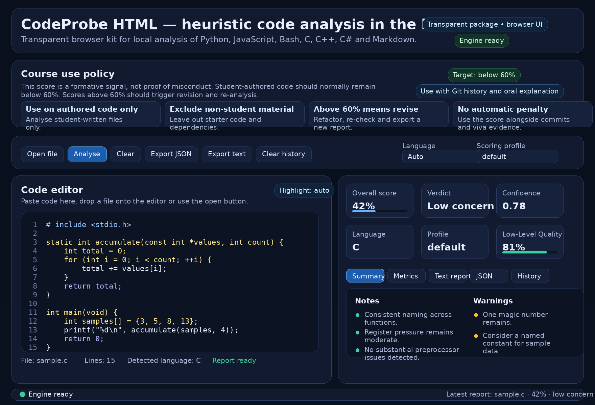

# Source-review implementation

This component provides the analysis implementation in **Source Review Evidence 1.0.0**. The distribution combines the source with retained computational records and the existing technical derivative **CP-FGCS-C2F2-FIX2**. Begin with the [distribution overview](../README.md) and [evidence guide](../docs/EVIDENCE_AND_SCOPE.md) for the research questions and outcomes.

## Implementation routes

The evidence-contract route separates source admission, observation availability, measured values, interpretation policy, source localisation and consumer admission. Its implementation is in `src/codeprobe_measurement_kernel.py`, `src/codeprobe_interpretation.py`, `src/codeprobe_reporting.py`, `src/codeprobe_review_contract.py`, `schemas/` and `research/`. Observations compose as a vector; one dimension does not compensate for another.

The retained browser, project-analysis and calibration application provides a compatibility route for formative review. It includes the historical aggregate, display bands and provisional review trigger. Those outputs have their documented software meaning; they do not establish authorship, misconduct, population error rates or the scientific adequacy of a source location.

The implementation inspects **Python, JavaScript-family code, Bash-family scripts, C, C++ and C#**, with a separate **Markdown documentation profile**. Submitted programs are inspected as text. Their code, dependencies and database queries are not executed.



*The preview illustrates the retained component interface. Its CodeProbe label identifies the implementation; the distribution version is 1.0.0.*

**Reading order:** [supported inputs](#supported-languages-and-source-extensions) · [project routes](#input-routes-folders-and-git-archives) · [quick start](#quick-start) · [reports](#reports-and-exports) · [limits](#input-limits-and-exclusions) · [component index](00-kit-index.md).

## At a glance

| Question | Current behaviour |
|---|---|
| Which programming languages? | Six analysis families: Python, JavaScript, Bash, C, C++ and C#. TypeScript/JSX/TSX use the JavaScript family; zsh/ksh files use the Bash family, with the qualifications below. |
| Single snippet or file? | Paste text or open a source file in `app/index.html`. Automatic detection can be overridden with a supported language. |
| Whole project? | Select a folder, multiple files or a local ZIP. Projects may contain several supported languages. The CLI accepts a folder or ZIP. |
| GitHub export? | A downloaded source ZIP is accepted within the limits. A detected single wrapper directory is normalised. CodeProbe itself does not clone a URL or inspect Git history. |
| Markdown? | Yes, as documentation-quality context. It does not contribute to the retained compatibility aggregate and it is represented separately in the evidence-contract route. |
| Word, PDF or spreadsheets? | **Not direct analysis inputs.** No PDF/OCR, Office extraction or spreadsheet analysis is implemented. |
| SQL or database files? | **Not supported as database or query-analysis inputs.** No database connection, schema introspection, query execution or record inspection is implemented. |
| JSON and CSV? | Used for specific configuration, calibration or report roles; accepting those roles is not generic dataset-analysis support. |
| Outputs? | Analysis reports in JSON and plain text. Calibration additionally produces a Markdown summary and CSV diagnostics. |
| Where does analysis run? | In a terminable browser worker or a local native Python process. The shipped browser configuration downloads a pinned Pyodide runtime; it is not a fully bundled offline application. |

## Supported languages and source extensions

This table follows the extension sets and language detector in [the runtime](src/codeprobe_runtime.py), not just the screenshot or file-picker filter.

| Analysis family / Language option | Recognised source extensions | Scope and qualifications |
|---|---|---|
| **Python** / `python` | `.py`, `.pyw` | Token and structure analysis, with AST-based metrics where parsing succeeds. Calibration and bound calibrated application require a successful Python AST parse on the executing runtime. Unbound analysis can return warning-bearing fallback diagnostics. |
| **JavaScript** / `javascript` | `.js`, `.mjs`, `.cjs`, `.jsx`, `.ts`, `.tsx` | Bounded lexical and structural extraction. TypeScript/JSX/TSX files are admitted; detected typed/generic headers and JSX require qualification. No type-checking, transpilation, module resolution or framework validation is performed. |
| **Bash** / `bash` | `.sh`, `.bash`, `.zsh`, `.ksh` | Bounded shell-text extraction. zsh/ksh files are admitted with the Bash subset below; dialect-specific syntax and shell execution are not validated. |
| **C** / `c` | `.c`, `.h` | Lexical and structural heuristics; no compiler, preprocessor execution, linking or binary analysis. A `.h` header may be classified as C++ from its contents. |
| **C++** / `cpp` | `.cpp`, `.cxx`, `.cc`, `.hpp`, `.hxx`, `.hh`; content-sensitive `.h` | C++ structural and quality heuristics, not standards-complete semantic analysis, template instantiation or build validation. |
| **C#** / `csharp` | `.cs` | C# lexical and structural heuristics. No Roslyn/.NET compilation, dependency resolution or runtime execution. |
| **Markdown** / `markdown` | `.md`, `.markdown` | Documentation metrics only. The retained compatibility aggregate is not applicable. The evidence-contract route preserves parser status and limitations separately. Fenced code is not recursively analysed as separate programmes. |

Extension matching is case-insensitive. Auto detection uses the precedence and finite shebang subset below. **Project admission is extension-based first:** an extensionless script, `.txt` file or unsupported-language file does not become an ordinary project source merely because the single-file detector could guess its contents.

For an ambiguous snippet, choose its actual supported language. For a mixed-language project, leave **Language = Auto** in the main interface; a forced language hint can be applied across its files. The compact project page uses per-file detection. In particular, `.h` classification is a heuristic, so inspect `language` in the report rather than assuming every header is C.

There are no dedicated analysers for Java, Go, Rust, R, PHP, Ruby, Swift, Kotlin, SQL, PowerShell, HTML, CSS or notebook JSON in this version. A text box accepting pasted text, an unknown-language fallback or the application itself using HTML/CSS does **not** establish support for those languages. Not every metric applies to every supported language; inspect metric applicability and warnings.

### Automatic language detection

Single-file detection applies a supported explicit hint first, then the recognised
case-insensitive extension, then a recognised first-line shebang, then the existing
content heuristics. The `.h` extension retains its C/C++ content heuristic.
Thus a `.md` file remains Markdown in Auto even if it contains a Python shebang;
a supported explicit hint can override that extension in single-file mode.

A shebang cue must start with `#!` at character zero of the first physical line,
with optional spaces or tabs before an absolute interpreter path. Basenames are
case-sensitive: `python`, `python` followed by ASCII version components such as
`python3.12`, `node`, `nodejs`, `deno`, `sh`, `bash`, `zsh` and `ksh` are recognised.
Empty, `.` and `..` path components and first-line ASCII control characters other than
tabs are outside the subset.
Direct interpreter arguments do not change that language cue; their validity is
not checked. The exact `/usr/bin/env` path supports exactly one recognised
interpreter basename, or `-S` followed by that basename and space/tab-separated
arguments. The `env` subset excludes environment assignments, other `env` options, quotes,
backslashes and variable expansion. It does not resolve PATH or establish that
an interpreter exists. Operating systems and `env` implementations have wider
and differing argument rules; see the [FreeBSD env manual](https://man.freebsd.org/cgi/man.cgi?query=env&sektion=1&format=html).

Leading whitespace or a BOM before `#!`, a later quoted shebang, a lookalike name
such as `python-tools`, or prose mentioning `python`, `node`, `deno` or `bash`
does not establish a shebang cue in the supplied text. File intake can strip an
encoding BOM before supplying decoded text; this differs from a raw API string
whose BOM is still present. The detector then examines content; without
a positive supported cue it returns `unknown` and preserves the language
uncertainty warning in JSON/text, including path-qualified project warnings.
This is a heuristic selection, not a confidence probability or syntax validation.
No shebang interpreter or submitted source is executed.

Project admission remains separate. The native `--include-documentation` option
admits the documented text extensions for subsequent detection; it does not admit
extensionless scripts. A supported code-language hint can force an admitted
project member's analysis; a Markdown project hint is ignored so that members
retain per-file detection. Both browser project routes retain their documented
admission policy: documentation is excluded and neither project interface offers
a documentation opt-in control. An API request enabling documentation is a
separate route.

### Markdown extraction boundaries

Markdown supplies documentation context with a finite structural extractor.
Its selected fence, heading, code-span and reference rules follow
[CommonMark 0.31.2](https://spec.commonmark.org/0.31.2/); this is not a complete
CommonMark renderer or conformance claim.

| Feature | CodeProbe extraction contract |
|---|---|
| Fenced blocks | Top-level openers have 0–3 leading spaces and at least three identical backticks or tildes. A closer uses the same character, is at least as long, has 0–3 leading spaces and only a space/tab suffix. Backtick opener information cannot contain a backtick. An unclosed block extends to document end. |
| Indented code | Lines at four or more indentation columns are excluded from these documentation features; tabs use four-column stops. Complete paragraph/container indentation semantics are outside the subset. |
| Headings | ATX headings and a single ordinary text line followed by a setext underline are recognised. Multiline setext paragraphs and nested container headings are outside the subset. |
| Code spans | Matching equal-width backtick runs are masked before hyperlink and prose counting; supported spans can cross lines within a prose block. Unmatched runs remain literal text. |
| Hyperlinks | Simple inline links and full, collapsed or shortcut references with same-line flat definitions at a paragraph boundary are counted once. Reference labels are limited to 999 characters, with whitespace collapsed and case-folded matching. Definitions and images are not hyperlink occurrences. |

Nested labels or destinations, multiline reference definitions, container/lazy
continuation rules, raw HTML and autolinks are not fully parsed; apparent syntax
inside such forms can still affect counts. The prose
word/token measures retain their ASCII-oriented rules; they are not multilingual
linguistic analysis. Read the `Markdown scope:` warning with the existing metric
details. Single-file browser results and file JSON/text retain that qualification,
as do documentation-enabled native/API project reports and exports.
Markdown's overall code score remains N/A, and Markdown members do not contribute
to a project code aggregate. Fenced source is neither executed nor recursively
analysed as a programme. Correcting counts does not validate editorial preferences
in the documentation metrics or establish authorship evidence.

### JavaScript and Bash extraction boundaries

These families use finite static extractors. A recognised unsupported form or
lexical error produces a warning; a partial inventory is not evidence that no
other functions or branches exist. The following boundaries govern extraction,
not the full syntax or behaviour of either language.

| Family | Supported extraction | Qualified forms |
|---|---|---|
| JavaScript literals | Ordinary strings/comments, regex literals in expression and control-parenthesis contexts, and template text with executable `${...}` expressions retained. Division after ordinary call/expression parentheses stays code. | Unterminated or unsafe delimiters and exceeded bounds. Regex/division classification is a contextual heuristic, not a complete ECMAScript parser. |
| JavaScript functions | Named declarations, including named exports; function expressions and block-bodied arrows in variable declarations or named object properties; ordinary methods. Balanced destructured parameters are recognised. | Typed/generic TypeScript headers and recognised unsupported function forms. Following ordinary functions can be recovered when their boundaries remain safe. |
| JSX | Detected simple expression spans are masked and explicitly qualified. | The enclosing function is a qualified omission; following ordinary functions can be recovered when their boundaries remain safe. Unsafe or unclosed spans prevent a safe later inventory. |
| Bash words and substitutions | `#` starts a comment at an unquoted token boundary; `alpha#beta` remains word data. Simple `${#name}` and `${name#prefix}` are data. Ordinary `$()` retains executable child code, including inside double quotes. | Backticks, process substitution, arithmetic and complex expansion forms. |
| Bash functions | Brace-delimited `name()`, `function name` and `function name()` forms, with ASCII names matching `[A-Za-z_][A-Za-z0-9_]*`; original names and physical start/end lines are retained. | Other shell function forms are outside this inventory; the admitted file extension does not establish dialect-specific support. |
| Bash here documents | Quoted/unquoted delimiters, queued documents and leading-tab removal for `<<-`; here strings and arithmetic shifts are distinguished from here documents. | Apparent executable or complex expansions in unquoted payloads are conservatively qualified, including escaped apparent forms. Payload text does not become ordinary shell structure. |

JavaScript delimiter nesting is bounded cumulatively to **32**, active template nesting to
**16**, function headers to **2,048 physical characters** before the body brace
and JSX recovery spans to **65,536 physical characters**. Bash command
substitutions are bounded to **16 active levels**, pending here documents to
**16**, each quote-removed delimiter to **128 characters** and each payload to
**65,536 physical characters**, including newlines before its terminator.
Header length starts at the first header character, including `export`/`async`
when present, and includes whitespace before `{`. JavaScript's delimiter budget
is shared across executable/template-expression/JSX contexts, including open
JSX tags; template `${...}` wrappers do not themselves consume that budget.
Bash parameter-text masking is bounded to **32 brace levels**; this does not
make nested or complex parameter expressions supported executable features.
The first value above each bound is diagnostic, not a silently truncated input.

JavaScript names retain `$`, `_` and Unicode spelling. The admitted start
categories are `Lu`, `Ll`, `Lt`, `Lm`, `Lo` and `Nl`; continuation adds `Mn`,
`Mc`, `Nd`, `Pc`, ZWNJ and ZWJ. Detected escapes and unsupported identifier forms
are diagnosed rather than converted to a valid-looking suffix. No Unicode
normalisation or escape decoding is performed; this is not semantic name
resolution. The Unicode category database belongs to the executing Python.

Function complexity uses the cleaned character interval of each extracted function.
Stored body/signature evidence remains original, line-based source and can
include neighbouring content on the same line. Comment, literal and here-document
masking preserves physical line positions; executable substitutions remain code
within the supported subset. These corrections do not validate every metric's
formula or imply that every score is invariant to changes in literal text.

File and project JSON/text preserve `JavaScript scope:`, `Bash scope:` and
language warning messages; project warnings identify the member path and appear
in both browser interfaces. Scope notes describe the finite contract. Detected
feature issues make dependent metrics unavailable and are refused by calibration
and bound profile application. See the [diagnostic and applicability contract](docs/03-report-schema.md#javascript-and-bash-diagnostics).
The language distinctions are described by the
[ECMAScript lexical grammar](https://tc39.es/ecma262/multipage/ecmascript-language-lexical-grammar.html)
and [Bash reference manual](https://tiswww.case.edu/php/chet/bash/bashref.html).

### C, C++ and C# extraction boundaries

These families use a bounded static extractor. Ordinary named functions and
methods with brace-delimited bodies can be inventoried; an omitted function is
not evidence that no function exists. Operator overloads, C# expression-bodied
members and headers exceeding **800 characters** remain outside that inventory;
C# lambda arrows also qualify the function inventory.
The header budget starts at its first non-whitespace character and includes
whitespace immediately before the opening `{`. Recognised omissions produce
extraction warnings, and metrics requiring a complete function inventory become
unavailable. The extractor does not expand macros or resolve conditional
compilation, types, includes or dependencies.

C/C++ comment masking recognises immediate backslash/newline continuations,
including split comment delimiters, while retaining physical line coordinates.
It preserves the C++ raw-string exception rather than splicing raw content.
Splices in ordinary code tokens and C++ splices with intervening spaces or tabs
are diagnosed as outside the supported subset. The language-level distinction is
defined in [C translation phases](https://www.open-std.org/jtc1/sc22/wg14/www/docs/n1570.pdf)
and [C++ raw-string tokenisation](https://eel.is/c++draft/lex.pptoken).

C# masking recognises ordinary, verbatim, raw and interpolated strings, including
nested strings within interpolation expressions. Raw quote delimiters are bounded
to **3–16 quotes**; active interpolation expressions to **16 levels**, with
expression delimiter nesting bounded to **32** and raw interpolation prefixes
to **16 dollar signs**. Raw opening-brace runs longer than the dollar-prefix
width and unparenthesised interpolation format/conditional suffixes introduced
by `:` are diagnosed as outside this subset. The whole interpolated literal
is masked, including its expressions: identifiers and branches inside those
expressions do not contribute structural features. This deliberate omission is
reported. Unterminated or mismatched delimiters and exceeded lexical bounds
produce warnings and suppress unsafe function extraction. These are lexical
boundaries, not verification of C# string values, indentation rules or compilation.
See [C# raw strings](https://learn.microsoft.com/en-us/dotnet/csharp/language-reference/tokens/raw-string)
and [interpolation](https://learn.microsoft.com/en-us/dotnet/csharp/language-reference/tokens/interpolated).

Identifier extraction retains source spelling. Its Unicode subset admits `_`
and categories `Lu`, `Ll`, `Lt`, `Lm`, `Lo` and `Nl` initially, adding `Mn`, `Mc`,
`Nd` and `Pc` for subsequent characters. C# verbatim spelling such as `@class`
remains an identifier. Unicode escapes and other categories receive a diagnostic;
names are not silently normalised, stripped or replaced by a suffix. This is a
lexical inventory, not semantic name resolution: for example, preserving `@name`
and `name` does not establish two different C# bindings. The category database
belongs to the executing Python runtime. See the
[C# identifier rules](https://learn.microsoft.com/en-us/dotnet/csharp/language-reference/language-specification/lexical-structure#643-identifiers).

Local declaration extraction separates the declared name from its initialiser:
`int a = x < y, b = 2;` declares `a` and `b`, not `y`. It accepts ordinary multiline
declarations and simple typedef aliases from preceding file-scope declarations
in the same file or from the inventoried function's lexical scopes. Parameters
and local objects can shadow those aliases. Each stripped logical statement is
bounded to **4,096 characters** before its semicolon and delimiter nesting to
**32**. Separate limits of **64 accepted typedef declarations** apply at file
scope and within each function, including nested scopes; repeated declarations
count towards the limit. Aliases are not imported from another function or file.
Numeric array extents used by the size proxy are limited to **nine ASCII decimal
digits**; longer digit sequences are diagnosed and extent expressions are not
evaluated. Complex or excessive declarations are qualified rather than guessed.
Dependent register-pressure, stack-depth and memory-access features
remain source-level proxies, not measurements of compiler allocation or runtime
memory use.

Read `warnings` alongside each metric's `applicable`, `detail` and `explanation`.
File and project JSON/text retain the diagnostics; projects also identify the
affected member path, and both browser interfaces display project warnings.
[Report schema notes](docs/03-report-schema.md#c-c-and-c-diagnostics) describe the
warning classes and their effect on applicability.

## Documents, databases and other file types

**Three roles must be kept separate:** a document shipped with the kit, a file admitted as analysis input and a configuration/report format. A format's presence in the repository does not mean the engine can read its contents as a document or dataset.

| File type | Analysis/import status | Practical handling |
|---|---|---|
| Markdown: `.md`, `.markdown` | Supported as single-file documentation context; excluded from browser project analysis by default. | Open individually and use Markdown. In the native CLI, `--include-documentation` admits supported documentation extensions subject to ignore rules. Markdown still does not contribute to the code aggregate. |
| Plain documentation: `.txt`, `.rst`, `.adoc` | Documentation extensions admitted by the native project's `--include-documentation` option; excluded by default. No dedicated reStructuredText or AsciiDoc parser. | Admission uses ordinary language detection, not conversion of the document format. Code-looking text can be detected as code; this option is **not** a universal guarantee of documentation-only scoring for every plain-text file. |
| A source snippet saved as `.txt` | Can be loaded or pasted in single-file mode and assigned a supported language. | For project analysis, preserve a suitable source extension instead of relying on content detection to bypass the extension filter. |
| Word/OpenDocument/RTF: `.doc`, `.docx`, `.odt`, `.rtf` | **No document-content extraction.** Not supported project source. | Export the relevant authored code to its real source language before analysis. |
| PDF, including scanned PDF | **No PDF parser, OCR, layout, equation or embedded-code extraction.** Excluded from project source. | Code transcribed or exported into a supported source file can be analysed as that new input; the original PDF is not thereby analysed. |
| Spreadsheets: `.xls`, `.xlsx`, `.ods` | **No workbook, formula, cell or sheet analysis.** | A CSV calibration manifest is a different, prescribed input role; arbitrary tabular data are not scored. |
| Presentations, images, audio, video and fonts | Not analysed as source or documentation content. | These can be present in a repository but do not contribute to the source-code aggregate. |
| Databases: `.db`, `.sqlite`, `.sqlite3`, `.mdb`, `.accdb`, `.dbf` and database backups/dumps | **No database ingestion or database engine support.** Not supported project source extensions. | SQLite, PostgreSQL, MySQL/MariaDB, SQL Server and other database systems are not queried. Application code using a database can be inspected if its own language is supported; database behaviour is not tested. |
| SQL scripts: `.sql` | **No SQL parser or query-quality analyser.** Excluded as an unsupported project source extension. | SQL strings inside Python/JavaScript/C# are not separately validated. A migration written in a supported language is still subject to the default `migrations/` exclusion. |
| General `.json`, `.csv`, `.tsv`, `.xml`, `.yaml`, `.yml`, `.toml`, `.ini` | Not generic code, document or dataset analysis inputs. | JSON metric overrides, JSON calibration profiles and CSV/JSON corpus manifests are accepted only through their specific controls/tools and expected structures. Repository configuration files do not automatically enter the project score. |
| Jupyter `.ipynb`, Parquet, HDF5, Avro, Protobuf and serialised objects | No notebook-cell, data-container, schema or object ingestion. | Export authored source into a supported file when appropriate. Do not rename a container to `.py` or `.txt` and treat that as extraction. |
| Executables, bytecode, libraries and object files | No decompilation or binary-code analysis. | `.exe`, `.dll`, `.so`, `.class`, `.pyc`, `.o` and similar files are excluded. |

The folder selectors may let you select files outside the supported set. That is not a promise to analyse them: project reports record admitted files and exclusions. Unsupported files may appear as `unsupported_extension`, `binary_or_non_source_extension`, an ignore match or a browser intake rejection. The first applicable check determines the recorded reason; it need not equal the label in this table.

## Input routes, folders and Git archives

| Route | What to provide | Important boundary |
|---|---|---|
| **Main browser page**: `app/index.html` | Pasted source, one source file, multiple selected/dropped files, a folder or a local `.zip`. | A single source file uses single-file mode. Folders, multiple files and a ZIP use project mode. Language, metric override and calibration controls are available. |
| **Compact project page**: `app/project.html` | A folder, dropped file collection or local `.zip`. | Project workflow, scoring mode, calibration and JSON/text export; no single-file editor or general document reader. |
| **Native project CLI**: `tools/analyze_project.py` | Exactly one of `--folder` or `--zip`. | Adds configurable bounded limits, `--include-documentation` and explicit configuration/ignore/profile files. It has no `--file` or remote-repository URL input. |
| **Python API**: `src/codeprobe_engine/api.py` | A structured file or project payload. | `analyse_file` and `analyse_project` wrap the runtime's JSON entry points. They are local functions, not a hosted REST service. See [architecture](docs/02-architecture.md) and [report fields](docs/03-report-schema.md). |

### GitHub and other Git source exports

Download a repository's **source ZIP** to your computer, then open/drop it in CodeProbe or pass it to `--zip`. An ordinary `git archive --format=zip` source snapshot is also a ZIP input. Exports from GitLab, Bitbucket or another host are handled as ordinary archives **when they meet the same ZIP, path and resource constraints**; no host-specific API integration is implied.

For a recognised single export wrapper such as `repository-main/`, CodeProbe removes that wrapper before applying project-root `.codeprobeignore` rules. `input_packaging` records the detected root, whether it was stripped and the reason. Common-root stripping is conservative: not every first-level directory is automatically removed.

A cloned working directory can be analysed with `--folder`; `.git/` is excluded. The tool does **not** fetch repository URLs, use the chat's GitHub connector, compare branches, inspect commits or establish who wrote a file. Supply Git history separately for human review. Git LFS objects and submodule content are not fetched: inspect the actual downloaded files rather than assuming the export contains those objects.

### Accepted and rejected archive forms

The project reader supports ordinary **single-volume ZIP archives with stored or deflated members**. It checks compressed size, entry count, member size, expansion ratio, aggregate limits and paths. Encrypted members, links/special members and unsupported compression methods are excluded; malformed archives, ZIP64 and multi-disk ZIP containers are refused. Review the report's inventory when only part of an archive was admitted.

`.tar`, `.tar.gz`, `.tgz`, `.gz`, `.bz2`, `.xz`, `.7z` and `.rar` are **not alternative project archive inputs**. Extract trusted source locally and analyse the resulting folder, or create a compliant source ZIP. A `.bundle` is a Git history transport, not a CodeProbe project ZIP. `.jar`, `.war`, Office containers and nested archives are not recursively unpacked for source analysis. Selecting an outer ZIP does not add support for unsupported files inside it.

## Quick start

Use the `source/` directory from the complete Source Review Evidence archive. Keep its `app/`, `src/`, configuration and tool paths together. The distribution-root [manifest](../DISTRIBUTION_MANIFEST.json) identifies the selected files; [validation records](../validation/RP2_VALIDATION.json) state which checks have actually run.

### Requirements

| Component | Requirement and boundary |
|---|---|
| Browser | Web Workers, WebAssembly, Web Crypto and file APIs. The retained browser harnesses target Chromium; the validation record identifies actual tested environments. Folder selection varies by browser. |
| Pyodide/network | The shipped configuration fetches pinned **Pyodide 0.25.0** core bytes from its configured CDN and verifies them. That configuration requires network access. |
| Native Python | The retained component documents Python **3.10–3.14** for its native tools. The current validation record identifies the interpreter actually exercised; browser analysis uses Pyodide's interpreter. |
| Node.js | Required by JavaScript checks and browser harnesses, not ordinary native analysis. Historical maintainer controls retain their own runtime pins. |
| Application build | Ordinary use requires no application build, npm package installation, database server or third-party Python package installation. |

The source distribution does not bundle the full Pyodide runtime. Native analysis can run without the CDN. A browser package described as offline would require its own reconciled runtime inventory, server controls and execution evidence; see [offline deployment](docs/05-offline-deployment.md).

### Launch the browser application

Run the following from `source/` on Windows:

```powershell
py -3 -I -S -B tools/run_local_server.py
```

On Linux or macOS:

```bash
python3 -I -S -B tools/run_local_server.py
```

If the Windows launcher is unavailable, use an installed `python` interpreter. Open the printed **Open** URL for the main page or **Project** URL for the compact page. The server chooses an available port and prints complete URLs. Keep it running during use and stop it with Ctrl+C. `--no-browser` prints the URLs without opening a browser automatically.

An explicit port can be requested with `--port 8123`; an occupied port causes a startup error. On a host with IPv6 loopback, `--host ::1` selects that interface. The server exposes declared application resources, including the engine, without publishing the whole repository or directory listings. `--allow-network` is required for non-loopback binding and does not provide authentication.

Paste or open the source, confirm **Language**, choose the applicable scoring mode and select **Analyse**. Keep Auto for a mixed-language project. Inspect admitted and excluded files, applicability, warnings and review guidance before exporting JSON or text. Cancelling terminates the worker; retry starts a new interpreter. Input or scoring changes invalidate the previous report and exports.

These commands run the supplied analysis component. Posting the distribution to GitHub and Zenodo follows the separate browser-only release guide.

## Command-line use

These examples assume that `work/submission/` and `work/submission.zip` are your actual inputs, while `work/reports/` is an **existing directory outside the analysed project**. Replace the paths accordingly; `work/` is illustrative, not a bundled sample dataset. On Windows, replace `python3` with `py -3` or `python` and use PowerShell's line-continuation syntax or a single line.

### Analyse a folder or a source ZIP

```bash
python3 -I -S -B tools/analyze_project.py \
  --folder work/submission \
  --json-out work/reports/submission.json \
  --text-out work/reports/submission.txt
```

```bash
python3 -I -S -B tools/analyze_project.py \
  --zip work/submission.zip \
  --json-out work/reports/archive.json \
  --text-out work/reports/archive.txt
```

With no `--text-out`, the text report is also printed to standard output. JSON output is opt-in through `--json-out`.

### Add documentation context or a bound calibration profile

```bash
python3 -I -S -B tools/analyze_project.py \
  --folder work/submission \
  --include-documentation \
  --json-out work/reports/with-context.json
```

`--include-documentation` permits `.md`, `.markdown`, `.txt`, `.rst` and `.adoc`; it does not permit DOCX, PDF, databases or spreadsheets and does not disable ignore rules. Refer to the plain-text detection caveat above.

```bash
python3 -I -S -B tools/analyze_project.py \
  --folder work/submission \
  --calibration-profile work/course/calibration_profile.json \
  --json-out work/reports/calibrated.json
```

Omitting `--profile` allows a bound calibration profile to select its calibrated scoring mode. An explicit incompatible mode/configuration is refused. Without a bound profile, the ordinary default applies; the available modes are `default`, `strict` and `permissive`. An additional `.codeprobeignore`-style file can be passed through `--ignore-file`; a metric-override object through `--config`. These files have prescribed roles, not arbitrary JSON/text semantics.

**Output safety:** JSON and text destinations must be distinct and must not alias the project, archive or auxiliary input files. Reports inside the analysed folder are refused, including new output names. Existing link/reparse-point or hard-linked destinations are refused, and parent directories must already exist. Each replacement is atomic, but the pair is not a filesystem transaction. The project command returns exit 2 on controlled input/output failure; exit 0 does not mean the score proves authorship.

For the exact flags and bounded native limits:

```bash
python3 -I -S -B tools/analyze_project.py --help
```

## Reports and exports

| Operation | Files or result | What is included |
|---|---|---|
| Browser file/project analysis | Downloadable **JSON** and **plain text (`.txt`)** | Identity, detected language(s), scores, metric details, warnings and manual-review guidance; projects add included/excluded inventories and packaging metadata. |
| Native project analysis | `--json-out`, `--text-out`; text on standard output when not written | The project report object and its readable text rendering. It does not require a database. |
| Calibration | `calibration_profile.json`, `validation_summary.md`, `calibration_observations.csv`, `threshold_sensitivity.csv` by default | The fitted policy, holdout diagnostics, sample observations and the fit-threshold sensitivity table; output paths can be selected explicitly. |

There is **no built-in DOCX, PDF, XLSX or HTML report export**. The browser HTML is an interface resource. JSON analysis reports are outputs, not calibration profiles to paste into the calibration input.

The file report schema is `2.2.0`; the project schema is `2.2.0-project`. Useful fields include `filename`/`project_name`, `language`, `metrics`, `overall_applicable`, `overall_score`, `decision_score`, `review_triggered`, `manual_review_guidance`, `engine_fingerprint`, `metric_config_digest` and `tool_metadata`. Project `input_packaging` records common-root handling and effective limits. `decision_score` retains the unrounded comparison value; displayed values may be rounded. See [report schema notes](docs/03-report-schema.md).

### Reading the result

The following score bands describe only the retained compatibility surface. They are not part of the evidence-contract research route and must not be used as origin, authorship or misconduct classifications.

Metrics are separated into stylometry, quality, context and documentation roles. Good formatting, generic structure or a documentation-quality result should not be treated as evidence of AI authorship. Projects combine applicable file scores using source-line weighting with a per-file cap of **500 SLOC**. This is not a cross-file compiler, dependency graph or semantic clone detector.

The current generic bands use the following thresholds for an applicable score:

| Unrounded score displayed as a percentage | Built-in reading |
|---|---|
| Below 28% | Low AI-style concern |
| 28% to below 48% | Moderate AI-style concern |
| 48% to below 68% | Elevated AI-style concern |
| 68% or higher | High AI-style concern |
| Not applicable | Documentation-only or insufficient applicable evidence; not a zero-risk certificate |

The **60% provisional review trigger is separate from these display bands** and uses an inclusive comparison: an applicable unrounded score of exactly 60% triggers review; 50% is elevated without reaching that trigger. A rounded display alone is not the comparison value. A local profile can change both; read the policy serialised with the actual report rather than applying a hard-coded band externally. The `confidence` label is an internal evidence-coverage heuristic, not a statistical confidence interval or a calibrated probability. Use independent code inspection, tests, development history and an explanation of the work; do not turn these bands into pass/fail marks or penalties.

## Course-local calibration

Calibration requires a real, appropriately authorised and labelled source corpus; the distributed templates do **not** contain an empirical validation dataset. CSV/JSON manifests specify labels, groups and fit/evaluation partitions or a supported group-exclusive split. Use the separate file-only and project-only templates: file profiles accept one detected language, while project profiles use the `project` scope marker and may contain supported mixed-language members. Do not mix file and project observations in one profile. Generic spreadsheet or database contents cannot be substituted for source samples.

After curating a manifest and the referenced files, an example command is:

```bash
python3 -I -S -B tools/calibrate_profile.py \
  --manifest work/course/corpus-manifest.csv \
  --profile-id intro-python-course-v1 \
  --label "Intro Python course" \
  --target-fpr 0.10 \
  --out-dir work/calibration-output
```

The paths above are illustrative. Start from [the manifest templates and executable workflow](calibration/README.md), replace their sample paths and labels with justified corpus records and keep outputs separate from the manifest and samples. Each JSON/CSV pair illustrates four explicitly partitioned observations with distinct declared groups, not a statistically adequate corpus. The folder wrapper does not infer authors or submission groups from nested directories. Use a generated project profile for the native project command above, not a file profile. `--target-fpr 0.10` requests a fit-partition target; it is not a claim that the software achieves a 10% real-world error rate.

Scoring mode, effective metric configuration and engine identity are bound before fitting/evaluation and checked on application. Selection uses the fit partition; the holdout is not used to tune the threshold. An unmet fit target produces a **non-operational diagnostic profile**, refused on application. Successful writing of diagnostics can return exit 0; inspect `operational` and `operational_reason` instead of inferring feasibility from the exit code.

Python calibration requires successful AST parsing, including relevant project members. A native interpreter accepting newer syntax does not make that syntax parsable by Pyodide's interpreter. Runtime metadata do not certify universal cross-version replay. Old unbound profiles remain provisional and must not be relabelled as verified replay contracts.

C-family calibration requires available lexical, function and declaration
features within the [documented subset](#c-c-and-c-extraction-boundaries), both
when scoring corpus samples and when applying a bound profile. An unresolved
feature issue aborts sample analysis or bound application; an ordinary scope
qualification alone does not. Re-fitting uses the actual source samples and
engine identity, not edited fingerprint fields in an older profile.

JavaScript/Bash calibration and bound application require available lexical and
function features within the documented subset, including admitted project
members. Both fitting routes request `require_script_features: true`; detected
feature issues abort sample analysis or bound application. An ordinary scope
note alone does not cause refusal. Engine/configuration identity changes require
re-fitting from the original curated corpus; editing profile hashes is not a
migration. Unbound diagnostic reports can retain qualified partial results.

Fresh UUID4 sample/group tokens are assigned for export after partitioning and fitting, including when the manifest supplies explicit identifiers. JSON/CSV observations share tokens within one export; no mapping is emitted. Repeated analytical values can agree while tokens and file digests vary. This is not anonymisation: scores, labels, row order, group sizes and free-text metadata can still permit linkage. Input manifests and the wrapper's generated manifest remain private. Source/release reproducibility is distinct from random calibration identifiers.

**CLI compatibility:** `--min-per-class-for-language` remains accepted as a hidden, deprecated and deliberately ignored alias so existing v2.2.0 scripts do not fail at argument parsing. Its value has no statistical or operational effect and no arbitrary minimum is inferred from it. New commands should omit it. Both shipped profile illustrations explicitly set `operational: false` and are refused on application. This compatibility shim does not change the score or threshold-selection formula.

See [calibration guide](docs/06-calibration-guide.md) and [contract reconciliation](docs/22-contract-reconciliation.md).

## Input limits and exclusions

Default byte counts below are decimal, not MiB/GiB. The applicable limits and exclusion inventory should be retained with the report.

| Boundary | Default |
|---|---:|
| Single browser source / individual project source | **1,000,000 bytes**; decoded/re-encoded text checks can also reject an input |
| Project source budget | **20,000,000 bytes** |
| Compressed outer ZIP | **8,000,000 bytes** |
| Project files admitted for analysis | **300** |
| ZIP entries / browser selection-entry bound | **2,000** |
| Maximum admitted ZIP-member expansion ratio | **100:1** |
| Project ignore text | **131,072 bytes**, at most **1,000 active rules** |
| Browser dropped-directory traversal | **2,000 entries including directories**, depth bound **32**, enumeration budget **10 seconds** |
| Browser worker startup / analysis watchdog | **60 seconds / 30 seconds** |

The native CLI exposes bounded overrides such as `--max-files`, `--max-file-bytes`, `--max-total-bytes`, `--max-entries`, `--max-archive-bytes` and `--max-compression-ratio`. This is not unlimited intake. The browser worker also bounds serialised requests/results; source size is not their only cost. Timer suspension, memory pressure, decoding, serialisation and rendering remain separate constraints, not hard real-time guarantees.

**Route matters near a budget:** browser folder intake can consume its raw read budget before documentation is excluded by the engine. Selection order may therefore affect which source files remain under that ceiling. ZIP prefiltering and native intake take different paths; do not assume identical admission for an oversized mixed-content selection. Inspect `overall_applicable` and excluded files, not just the score.

Built-in exclusions cover version-control/editor metadata, dependencies, build output, generated directories, migrations, common binaries and minified/bundled assets. Examples include `.git/`, `node_modules/`, `vendor/`, `dist/`, `build/`, `generated/`, `migrations/`, `*.min.js` and `*.bundle.js`. Some long-line JavaScript assets are also excluded heuristically as minified; inspect the reason rather than assuming authorship.

Copy [`.codeprobeignore.example`](.codeprobeignore.example) to the **root of the project being analysed**, naming it `.codeprobeignore`, and customise it for starter code, third-party material and files outside the assessed task. The reader supports comments, directory/glob patterns and negated re-inclusions, subject to safety/type limits. Nested `.codeprobeignore` files do not establish independent policies; `.gitignore` is not automatically imported. Re-inclusion does not add a parser for an unsupported format or bypass a size/path boundary.

Native folder readers reject unsafe links and special entries. Paths are normalised, including Unicode NFC, and unsafe/duplicate paths are refused or excluded as appropriate to the route. Browser pre-read rejection records preserve bounded selection metadata, not authenticated missing file contents. Archive-level failure may prevent a report entirely.

## Browser security, privacy and access

Both pages execute Python through an authenticated, terminable worker. The HTML uses Content Security Policy without `unsafe-inline`; scripts and styles are external. Local integrity metadata and SRI protect packaged resources. The loader verifies the five required Pyodide core artefacts and the engine bytes actually consumed, rather than trusting an unchecked second network response. This does not authenticate optional packages, upstream builds or the complete current vulnerability state.

Analysis is local to the executing browser/native process; the kit has no remote submission-analysis API. Browser startup still contacts the configured runtime host. The **manual engine-file override is explicitly unverified**; never use it to bypass an unexplained integrity failure or treat a worker as a security sandbox for a malicious replacement engine.

Report history in the main page is disabled by default and uses browser `localStorage` when enabled; there is no application SQL/NoSQL database. It stores reports rather than source text, but report metadata, filenames and scores can still be sensitive. **Clear privacy data** clears the current session and invalidates pending work even if persistent storage fails. When stored-report deletion cannot be verified, the interface warns that stored data may remain. This is not forensic erasure of browser memory or disk.

Both interfaces include labelled inputs, live status, visible keyboard focus and semantic score progress. The main result tabs support Left/Right and Home/End navigation. The retained Chromium accessibility harness specifies checks for this interface. Its execution status for this distribution is recorded in the current validation record.

See [browser security](docs/04-browser-security.md), [runtime integrity](docs/18-runtime-integrity.md), [worker resilience](docs/20-worker-resilience.md), [runtime lifecycle](docs/21-runtime-lifecycle.md) and [security policy](SECURITY.md).

## Component layout

The component retains its runtime paths while its documentation and release metadata describe the new distribution. The [file catalogue](docs/00-file-catalogue.md) lists the selected component paths.

| Path | Role |
|---|---|
| `app/` | Main and compact browser pages, worker, loader, UI assets and runtime configuration |
| `src/` | Analysis runtime, evidence-contract modules and native support |
| `tools/` | Native analysis, calibration, server and retained maintainer utilities |
| `docs/` | Technical contracts, component guides and interface preview |
| `calibration/` | Input/profile templates and interpretation guidance |
| `provenance/`, `reproducibility/` | Inherited component identities and historical evidence boundaries |
| `research/`, `schemas/` | Observation, claim, construct and consumer contracts |
| `tests/` | Retained regression tests, with documented adaptations where the distribution boundary changed |
| `release/` | Component-facing views of current inventory and validation metadata |

The distribution-root [citation metadata](../CITATION.cff), [data guide](../docs/DATA.md) and [component-rights guide](../docs/COMPONENT_RIGHTS.md) govern this package. The interface preview is an illustration, not a research result. Supported input formats are determined by the implementation, not by the document formats used during its development.

## Distribution validation

From the distribution root, the current integrity check is:

```bash
python3 tools/verify_distribution.py
```

It compares the current files with `DISTRIBUTION_MANIFEST.json` and emits a JSON result. Read [the integrity contract](docs/09-release-integrity.md) for its scope. The [RP2 validation record](../validation/RP2_VALIDATION.json) identifies executed checks, environment, failures and unexecuted routes.

The retained `tools/check_release.py`, `tools/check_coverage.py`, `tools/build_release.py` and related utilities describe the older component's maintenance protocol. Their input inventories, runtime pins and evidence expectations differ from this distribution. They are not the release gate or browser publication procedure for Source Review Evidence 1.0.0. Historical locks remain tied to their original inputs.

An implementation change requires checks targeted at its affected behaviour and a recorded source difference. A documentation or inventory update cannot establish an unexecuted browser route, a fresh-environment qualification or a new scientific result. See [reproducibility](../docs/REPRODUCIBILITY.md).

## Citation and component rights

Use the distribution-root [CITATION.cff](../CITATION.cff), version **1.0.0** and the exact archive identity used. The public record identifier is added when the record exists. Older CodeProbe versions and the FIX2 identifier remain component provenance; they are not the new record's citation identity.

Existing source, copyright and third-party notices retain their stated scope. The [component-rights guide](../docs/COMPONENT_RIGHTS.md) records the applicable boundaries. A component licence does not silently grant rights over every retained record or external prerequisite.
